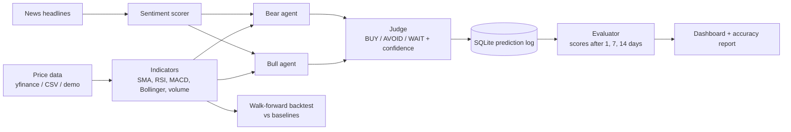

# AI-Assisted Stock Analysis System

A transparent **Bull / Bear / Judge debate** over technical indicators and news sentiment for Shariah-compliant stocks, with a **prediction log that tracks real accuracy over time**.

> Educational project. Output is decision support, not financial advice. Markets are hard to predict, so the system is judged by its tracked accuracy, not by claims.

## Why this project

Most student "stock predictors" are black-box models that report a high accuracy on a back-tested dataset. This project takes a different approach:

- **Explainable:** every call lists the exact evidence behind it, for and against.
- **Honest:** calls are logged with the price at the time and scored later against what really happened.
- **Benchmarked:** a walk-forward backtest compares the system with simple baselines (always-buy, plain RSI rule).
- **Halal-focused:** the watchlist is meant to hold Shariah-compliant stocks only (verify each with a screener such as Zoya).

## How it works



1. **Indicators** (`indicators.py`): SMA 20/50, RSI 14, MACD, Bollinger bands, volume ratio. All are causal (a day's value uses only past data).
2. **Sentiment** (`sentiment.py`): word-list headline scorer with negation handling. Every score shows the words behind it.
3. **Debate** (`agents.py`): the Bull and Bear agents each score the evidence for their side. The Judge acts only if the gap is large and consistent enough; otherwise the call is **WAIT**.
4. **Tracker** (`tracker.py`): each call is saved at three horizons (1, 7 and 14 days). When a horizon passes, the real price is fetched and the call is scored.
5. **Backtest** (`backtest.py`): walk-forward test on history with no look-ahead, compared with baselines.

### Scoring rules

| Call | Counts as correct if |
|------|----------------------|
| BUY | price rose at the horizon |
| AVOID | price fell at the horizon |
| WAIT | price moved less than 1% either way |

## Quick start

```bash
git clone https://github.com/Ashikjafar/ai-assisted-stock-analysis-system.git
cd ai-assisted-stock-analysis-system
python -m venv .venv && source .venv/bin/activate    # Windows: .venv\Scripts\activate
pip install -r requirements.txt
```

**Offline demo (no internet, synthetic data):**

```bash
PYTHONPATH=src python -m stock_analysis analyze --demo TCS.NS
PYTHONPATH=src python -m stock_analysis backtest --demo TCS.NS
```

**Live data:**

```bash
PYTHONPATH=src python -m stock_analysis analyze TCS.NS INFY.NS   # analyse and log calls
PYTHONPATH=src python -m stock_analysis evaluate                 # score calls that are due
PYTHONPATH=src python -m stock_analysis report                   # live accuracy summary
PYTHONPATH=src python -m stock_analysis backtest TCS.NS          # walk-forward vs baselines
```

(On Windows PowerShell set the path first: `$env:PYTHONPATH="src"`.)

**Dashboard:**

```bash
streamlit run app.py
```

**Tests** (no extra packages needed):

```bash
python -m unittest discover -s tests -v
```

## Project structure

```
app.py                      Streamlit dashboard
src/stock_analysis/
  config.py                 watchlist, horizons, thresholds
  data.py                   prices, headlines, offline synthetic data
  indicators.py             technical indicators
  sentiment.py              headline sentiment
  agents.py                 bull / bear / judge
  tracker.py                SQLite prediction log and accuracy
  backtest.py               walk-forward evaluation and baselines
  cli.py                    command line interface
tests/test_system.py        unit tests
docs/PRESENTATION.md        slide outline and viva Q&A
```

## Limitations (be upfront about these)

- Rule weights are hand-set, not learned. They are a transparent starting point.
- Historical news is not available, so the backtest runs with neutral sentiment. Sentiment only affects live calls.
- Only a few weeks of live tracking will exist at presentation time, so the live sample is small. Report the sample size next to any accuracy number.
- The word-list sentiment scorer is simple. It can be replaced with a model such as FinBERT behind the same interface.
- The default watchlist is a candidate list. Verify Shariah compliance yourself.

## Future work

Learn the rule weights from data, add FinBERT sentiment, add position sizing and risk limits, and add more markets.

## Disclaimer

For education only. Nothing here is financial advice. Never trade money you cannot afford to lose.
